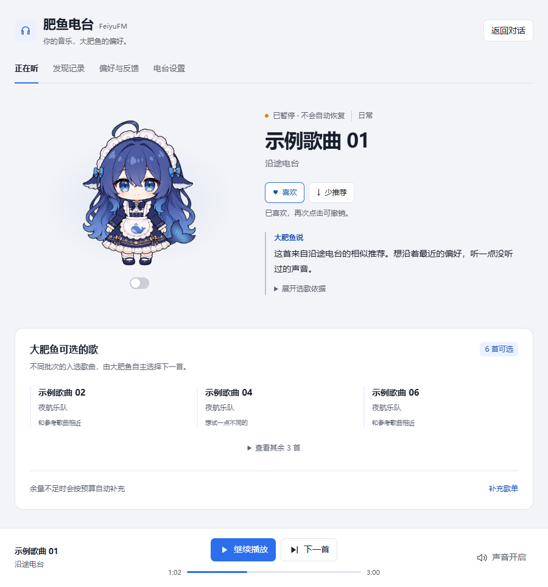

# 肥鱼电台 FeiyuFM


**在 DeepSeek Harness（DSH）里，开一间由你掌控的电台。**

导入常听的歌曲，让网易云找来候选，再由模型挑出一批。大肥鱼陪你听歌；点播、暂停、换曲和静音，随时由你决定。

**Windows · 网易云 · 0.1.1**　[开始使用](#开始使用) · [下载发行包](https://github.com/A7m0spHere/dsh-feiyuFM/releases/tag/v0.1.1) · [使用说明](https://github.com/A7m0spHere/dsh-feiyuFM/blob/main/docs/DELIVERY.md) · [更新记录](https://github.com/A7m0spHere/dsh-feiyuFM/blob/main/CHANGELOG.md)

**main 已新增逐行歌词和点击跳转，尚未发布到 npm。** 正式版 `0.1.1` 不包含歌词功能；提前体验请按下方说明从 main 源码安装。本轮按 Windows／网易云范围合并，macOS 继续保持实验性。

## 电台长什么样

<picture>
  <source media="(prefers-color-scheme: dark) and (max-width: 600px)" srcset="https://raw.githubusercontent.com/A7m0spHere/dsh-feiyuFM/main/assets/readme/panel-narrow-dark.png?v=20261105">
  <source media="(prefers-color-scheme: dark)" srcset="https://raw.githubusercontent.com/A7m0spHere/dsh-feiyuFM/main/assets/readme/panel-dark.png?v=20261105">
  <source media="(max-width: 600px)" srcset="https://raw.githubusercontent.com/A7m0spHere/dsh-feiyuFM/main/assets/readme/panel-narrow.png?v=20261105">
  
</picture>

截图取自 2026-11-05 的 main 客户端预览，展示尚未发布的歌词界面；歌曲、歌词、账号状态与模型结果均为示例数据。实际安装与试用边界见 [U26 记录](https://github.com/A7m0spHere/dsh-feiyuFM/blob/main/docs/spikes/U26-console-lyrics.md)。

## 开始使用

在 DSH「插件 → 添加插件」的「包名或地址」中输入：

```text
dsh-feiyufm@0.1.1
```

安装后点击「立即启用」，然后：

1. 打开侧栏「肥鱼电台」，在「电台设置」里用网易云 App 扫码登录。
2. 导入近期播放、喜欢的歌曲或指定歌单，作为参考歌曲。
3. 使用 DSH 已配置的模型挑歌，或者直接从输入曲库点播。没有配置模型也可以手动听歌。

首次使用时，「正在听」会显示三步引导。跳过或完成后，也可以在「电台设置 → 使用指南」重新打开。

<details>
<summary>提前体验 main 的歌词功能（尚未发布）</summary>

在「插件 → 添加插件」的「包名或地址」中使用：

```text
https://github.com/A7m0spHere/dsh-feiyuFM
```

已有安装先通过插件管理器更换来源，同一 profile 只启用一份肥鱼电台。保留现有音乐数据库与登录状态，安装启用后从应用菜单或托盘完整退出 DSH，再重新启动，才能载入新的播放后端。

打开「正在听」即可查看当前句高亮的逐行歌词。默认只显示原文；词源有翻译或音译时，可分别开启。点击某句歌词或用键盘 Enter／Space 跳到该句，暂停时跳转仍保持暂停；手动浏览后可点「回到当前句」恢复跟随。

源码安装、固定提交和本地打包方式见 [使用说明](https://github.com/A7m0spHere/dsh-feiyuFM/blob/main/docs/DELIVERY.md#安装) 与 [贡献指南](https://github.com/A7m0spHere/dsh-feiyuFM/blob/main/CONTRIBUTING.md#打包与发行)。

</details>

<details>
<summary>通过 DSH CLI 安装</summary>

以 Web profile 为例，将 `web` 换成实际使用的 profile：

```sh
dsh plugin --profile web add dsh-feiyufm@0.1.1 --registry https://registry.npmjs.org/
```

安装后重启该实例。单独运行 `npm install` 不会完成 DSH 插件注册和启用。

</details>

<details>
<summary>从旧版本升级</summary>

跟随正式版可安装 `dsh-feiyufm@latest`。如果安装过旧测试包 `dsh-feiyufm-core`，先在插件管理器移除旧来源，再添加新包；同一 profile 只启用一份肥鱼电台。

升级时保留同一 profile 的音乐数据库。后端更新后，从托盘完整退出 DSH，再重新启动。

</details>

## 电台怎样选歌

**参考歌曲 → 网易云找歌 → 模型挑歌 → 本地播放**

网易云提供相似歌曲、每日推荐等候选；模型结合参考歌曲和反馈挑选，并给出简短理由。自动续播只从入选歌曲中选择，逐曲播放和「下一首」不请求模型。

电台会在可播歌曲不足时按预算补充。自动续播、普通下一首和推荐队列避开最近 50 次实际开始的歌曲；歌曲不足时等待补充。手动点播和历史导航仍可重播。

模型根据歌曲信息和反馈选歌，当前不理解音频内容；歌曲能否播放取决于网易云账号权限和资源状态。

<details>
<summary>补歌和模型预算</summary>

窗口外可播余量降到 12 首时开始补充，达到 24 首时停止。初始共享日预算为 100000 tokens，可在设置中调整；筛选没有固定每日次数或成功冷却，相同候选和已评审的偏好不会重复请求。详细规则见 [控制契约](https://github.com/A7m0spHere/dsh-feiyuFM/blob/main/docs/CORE_CONTRACT.md)。

</details>

## 听歌时可以做什么

- **控制播放：** 点播、暂停、上一首或下一首；自动事件不会撤销你主动暂停的状态。
- **查看歌词（main）：** 当前句高亮并自动跟随，翻译／音译按需开启，点击歌词跳转；无词、纯音乐和没有时间信息的歌词分别显示，读取失败可重试。
- **调整偏好：** 用「喜欢／少推荐」影响后续挑歌，也可以撤销；不会修改网易云收藏。
- **切换页面：** 正在听、发现记录、偏好与反馈、电台设置共用音乐服务；切页或隐藏悬浮条后继续播放。
- **选择听歌方式：** 日常、专注、静听和关闭四种模式；静听关闭电脑声音，仍记录有效经历。「今天停止」可随时手动恢复。
- **调整画面：** 切换浅色／深色和动态效果，或开启工作区左缘的 ASCII 频谱；频谱是模拟动画。角色区的小开关可以切换 doll 彩蛋，默认关闭。

<details>
<summary>没有声音，或暂时不能补充歌单？</summary>

- **没有声音：** 检查声音开关、静听模式、暂停状态，以及系统音量和输出设备。首次播放可能等待数秒。
- **不能补充歌单：** 当前任务、预算或平台节流可能限制请求；等待期间仍可点播、暂停或换曲。
- **网易云连接读取失败：** 按提示重试连接；如果提示运行依赖缺失，重新安装 `dsh-feiyufm@0.1.1` 并完整重启 DSH。
- **升级后没有变化：** 从托盘完整退出 DSH 再启动；升级不需要删除音乐数据库。

更多排查方法见 [使用说明](https://github.com/A7m0spHere/dsh-feiyuFM/blob/main/docs/DELIVERY.md#常见问题)。

</details>

## 支持范围

| 项目 | 当前范围 |
| --- | --- |
| Windows + 网易云正式版 | npm `0.1.1`；发布范围见 [发行记录](https://github.com/A7m0spHere/dsh-feiyuFM/blob/main/docs/releases/0.1.1.md)，歌词尚未包含 |
| Windows + 网易云 main | 新增逐行歌词与原地跳转，审查回归通过；日常试用的代码版本、已验范围与缺口见 [开发状态](https://github.com/A7m0spHere/dsh-feiyuFM/blob/main/docs/PROJECT_PLAN.md) |
| DSH / Node.js | 本机隔离验证 DSH `0.2.1-rc.5`；Node `>=24.14.0 <25`，桌面宿主自带兼容版本时无需另装 |
| macOS | 实验性适配随包提供；真实登录、音频与退出生命周期待真机验收 |
| QQ 音乐 | 接入暂缓，当前没有可用登录与播放链路 |

长期体验、平台与宿主组合的未验项见 [开发状态](https://github.com/A7m0spHere/dsh-feiyuFM/blob/main/docs/PROJECT_PLAN.md)。

## 数据与开发

曲库、偏好、反馈、收听历史和用量账本保存在本机，默认位于 `$DSH_HOME/fishfm/music.sqlite`。网易云会话由 Windows DPAPI 或 macOS Keychain 保存，数据库只保存凭据引用。模型接收有界的音乐事实，不接收 Cookie 或凭据；歌词仅用于显示，不进入模型输入。详见 [架构](https://github.com/A7m0spHere/dsh-feiyuFM/blob/main/docs/ARCHITECTURE.md) 和 [控制契约](https://github.com/A7m0spHere/dsh-feiyuFM/blob/main/docs/CORE_CONTRACT.md)。

[参与开发与源码安装](https://github.com/A7m0spHere/dsh-feiyuFM/blob/main/CONTRIBUTING.md) · [文档索引](https://github.com/A7m0spHere/dsh-feiyuFM/blob/main/docs/README.md) · [反馈问题](https://github.com/A7m0spHere/dsh-feiyuFM/issues)

鲸鱼娘（大肥鱼）形象由 **@ZipZipPipe** 基于 **上善无形** 的原创角色进行二次设计。来源与完整版权说明见 [版权声明](https://github.com/A7m0spHere/dsh-feiyuFM/blob/main/THIRD_PARTY_NOTICES.md)。
