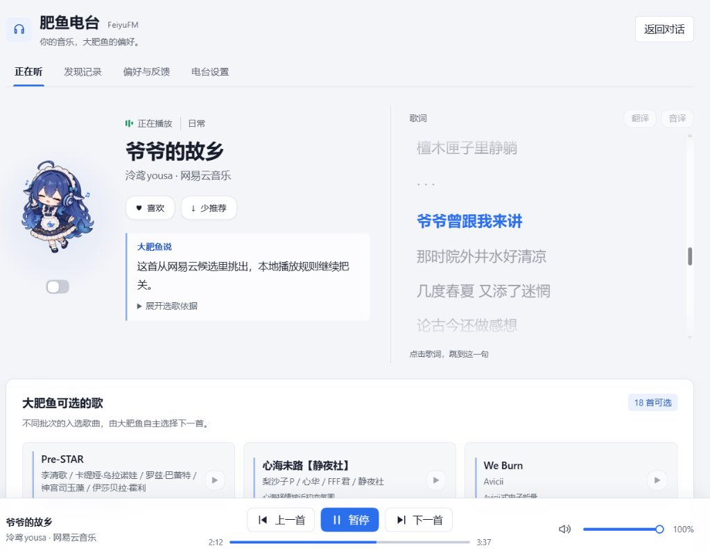
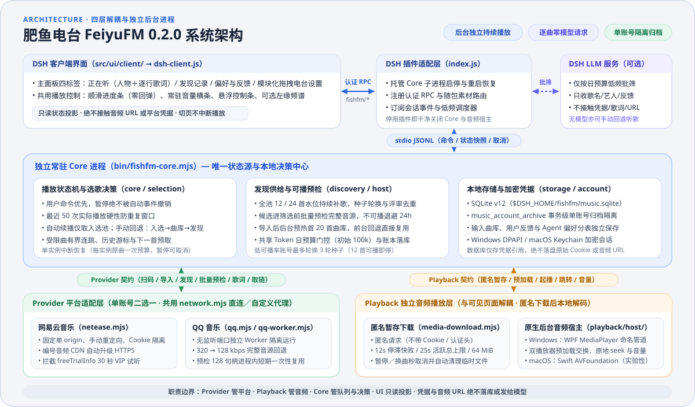

# 肥鱼电台 FeiyuFM


**在 DeepSeek Harness（DSH）里，开一间由你掌控的电台。**

导入常听的歌曲，由当前连接的音乐平台（**网易云音乐** 或 **QQ 音乐**）召回完整可播候选，再交由 DSH 已配置的模型按预算挑出一批。大肥鱼在独立后台播放服务里陪你听歌；点播、暂停、切歌、拖拽进度、调音与静音，控制权始终在你手里。

**Windows · 网易云 & QQ 音乐 · v0.2.0**　[快速开始](#快速开始) · [GitHub Release v0.2.0](https://github.com/A7m0spHere/dsh-feiyuFM/releases/tag/v0.2.0) · [使用说明](https://github.com/A7m0spHere/dsh-feiyuFM/blob/main/docs/DELIVERY.md) · [更新记录](https://github.com/A7m0spHere/dsh-feiyuFM/blob/main/CHANGELOG.md)

> **发行状态**：**`dsh-feiyufm@0.2.0` 已正式上架 [npm](https://www.npmjs.com/package/dsh-feiyufm)（`latest = 0.2.0`）与 [GitHub Release v0.2.0](https://github.com/A7m0spHere/dsh-feiyuFM/releases/tag/v0.2.0)**，两处公开 `.tgz` 字节与 SHA-256 摘要完全一致，空缓存消费安装校验通过。升级后请从系统托盘**完整退出并重开 DSH**，保留原有音乐数据库与登录凭据。详细发行与验收边界见 [0.2.0 发行记录](https://github.com/A7m0spHere/dsh-feiyuFM/blob/main/docs/releases/0.2.0.md)。

---

## 核心特性

- **双平台单账号隔离**：同时支持 **网易云音乐** 与 **QQ 音乐** 扫码接入。同一实例每次连接一个账号，曲库、反馈、听歌历史与推荐池按账号归档隔离，退出即可无缝切换平台；从 `0.1.x` 升级支持显式恢复旧版资料。
- **自动跳过 VIP／受限与试听曲目**：按当前账号实际能获取的完整非试听音源批量预检，拦截网易云 30 秒试听与平台无完整链接曲目（绝不绕过平台会员或版权限制）；免费账号输入曲库可播曲较少时，手动「开始听歌／下一首」可回退至平台已预检可播的相似新歌。
- **低频模型挑歌，逐曲零额外请求**：`参考歌曲 → 平台发现与可播预检 → 模型批筛 → 本地播放`。模型只在余量不足或手动触发时按预算批筛，逐曲播放与切歌不请求模型；最近 50 次实际播放采用硬性防重复窗口。
- **顺手且完整的播放控制台**：
  - 独立后台播放服务（WPF 原生音频宿主），切回对话页或隐藏悬浮条仍持续播放；
  - 「正在听」右侧逐行歌词高亮跟随、翻译／音译独立开关与点击歌词原地跳转；
  - 底栏与悬浮条共用可拖动进度条（悬停预览、拖动零回弹、键盘微调与暂停态定位）及常驻 0%–100% 音量横条与静音记忆；
  - 「电台设置」支持模块化卡片拖拽排序、展开／宽展、自动补齐空白与本机布局保存；
  - 支持浅色／深色主题、动效档位、左缘模拟 ASCII 频谱背景，以及角色区默认关闭的无文字彩蛋小开关。
- **可控网络与更稳的音频下载**：电台设置内置应用层直连／自定义无认证 HTTP(S) 代理（不干扰外部 TUN／VPN）；公网音频匿名暂存采用 12 秒停滞快败＋25 秒活跃下载总上限，暂停或切歌随时立即取消。

---

## 界面预览



<sub>实机截图取自 2026-11-28 Windows 日常 DSH Desktop 运行 `0.2.0`：展示宽屏无缝画布、人物与歌曲信息、「大肥鱼说」选歌理由、同步高亮逐行歌词、可选歌曲池、底栏顺滑进度条与 0%–100% 音量横条。</sub>

---

## 架构讲解



肥鱼电台采用 **「四层解耦 + 独立后台 Core 进程」** 架构，确保可见页面关闭、切回对话或隐藏悬浮条时播放不中断，同时把平台凭据、音频 URL 与模型调用严格隔离在各自边界内：

1. **DSH 客户端界面与插件适配层（`src/ui/client/`、`index.js`、`src/dsh-adapter.mjs`）**
   - 客户端只读取 Core 投影的状态快照，**绝不接触音频 URL 或平台凭据**；所有播放控制与设置读写都经 DSH 认证 RPC（`fishfm/*`）与版本号护栏校验，迟到响应不会覆盖用户最新操作。
   - 插件适配层负责托管独立 Core 子进程启停、暴露随包静态素材路由，并在收到 DSH 会话事件或待播池低水位信号时按预算触发低频模型调用；停用插件会干净终止 Core 与音频宿主。
2. **独立常驻 Core 进程（`bin/fishfm-core.mjs`、`src/core.mjs`、`src/core-host.mjs`）**
   - 作为整个电台的**唯一状态源与决策中心**，通过 `stdio JSONL` 与宿主通信，不依赖浏览器页面存活。
   - **播放状态机与选歌决策**：用户命令永远优先（主动暂停不会被自动事件撤销）；维护最近 50 次实际播放的硬性防重复窗口；默认 `filtered` 自动续播只取模型入选池，手动「开始听歌／下一首」按 `入选池 → 输入曲库 → 已预检可播平台发现` 三段有界回退。
   - **本地持久化与单账号隔离**：数据存在 `$DSH_HOME/fishfm/music.sqlite`（SQLite v12），通过 `music_account_archive` 在切号时事务级归档与恢复曲库、历史、反馈与推荐池；用户偏好与 Agent 长期偏好分表保存；凭据正文交由 Windows DPAPI／macOS Keychain 加密，数据库只存引用。
3. **Provider 平台适配层（`src/providers/`）**
   - 单账号二选一连接 **网易云音乐**（单 origin、手动重定向、HTTPS CDN 升级、拦截 30 秒 VIP 试听）或 **QQ 音乐**（无监听端口独立 Worker 隔离、320→128 kbps 完整音源回退、预检 128 句柄进程内短期一次性复用）。
   - 统一提供批量 `checkPlayability` 完整可播预检（不返回或落盘 URL）与共享应用层网络策略（`src/network.mjs`：默认直连或自定义无认证代理）。
4. **Playback 独立播放层与原生音频宿主（`src/playback/`）**
   - 公网音频先由 Node 侧匿名暂存下载器（不带 Cookie、12 秒停滞快败＋25 秒活跃下载总上限、64 MiB 上限）完整落盘后再交付本地解码，暂停或换曲立即中止并清理临时文件。
   - Windows 使用 WPF `MediaPlayer` 命名管道后台宿主，支持双播放器预加载无缝切换、原地 `seek` 与常驻音量控制；macOS 随包提供 Swift `AVFoundation` 实验性适配。

完整模块边界与数据流详见 [架构文档](https://github.com/A7m0spHere/dsh-feiyuFM/blob/main/docs/ARCHITECTURE.md) 与 [控制契约](https://github.com/A7m0spHere/dsh-feiyuFM/blob/main/docs/CORE_CONTRACT.md)。

---

## 快速开始

### 1. 安装插件

在 DSH 侧栏打开 **「插件 → 添加插件」**，在「包名或地址」中任选以下方式之一：

- **方式 A — 从 npm 安装（推荐，`latest` 已指向 `0.2.0`）**：
  ```text
  dsh-feiyufm@latest
  ```
- **方式 B — 使用 GitHub Release `v0.2.0` 离线安装包（内含完整依赖，最快最稳）**：
  前往 [Release v0.2.0](https://github.com/A7m0spHere/dsh-feiyuFM/releases/tag/v0.2.0) 下载 `dsh-feiyufm-0.2.0.tgz`，在「包名或地址」中填入本地文件路径（如 `D:\Downloads\dsh-feiyufm-0.2.0.tgz`）。
- **方式 C — 从 GitHub `main` 安装**：
  ```text
  https://github.com/A7m0spHere/dsh-feiyuFM
  ```

安装完成后点击 **「立即启用」**，然后**从系统托盘完整退出并重新打开 DSH**。

### 2. 三步开始听歌

1. 点击侧栏 **「肥鱼电台」**，按「正在听」的三步引导进入 **「电台设置 → 输入与连接」**，任选 **网易云音乐** 或 **QQ 音乐** 扫码登录。
2. 导入近期播放、喜欢歌曲或指定歌单作为参考曲库。
3. 在 **「电台设置 → 模型与推荐」** 选择 DSH 已配置的模型并点「找一批歌」开启自主听歌；即使暂未配置模型，也可以直接点击播放或「下一首」收听曲库与平台可播相似推荐。

<details>
<summary>通过 DSH CLI 安装</summary>

以 `web` profile 为例（替换为实际 profile 名称）：

```sh
dsh plugin --profile web add dsh-feiyufm@latest --registry https://registry.npmjs.org/
```

或直接离线安装下载好的 Release 包：

```sh
dsh plugin --profile web add /path/to/dsh-feiyufm-0.2.0.tgz --offline
```

安装后重启对应 DSH 实例。单独运行 `npm install` 不会完成 DSH 插件注册与启用。

</details>

<details>
<summary>从旧版本（0.1.x）升级</summary>

1. 在同一 profile 的插件管理器中**移除旧版 `dsh-feiyufm`（或旧测试包 `dsh-feiyufm-core`）**，避免同一 profile 同时启用两份插件；
2. **不要删除 `$DSH_HOME/fishfm/`**，原有音乐数据库、偏好与凭据都会保留并自动迁移到单账号结构（SQLite v12）；
3. 添加新版来源并点击「立即启用」，随后从系统托盘**完整退出并重开 DSH**；只关闭窗口或刷新页面不会替换已加载的后端模块；
4. 若旧库数据尚未归属到当前账号，可在「电台设置 → 输入与连接」点击「恢复旧版资料到当前账号」。

</details>

---

## 电台怎样选歌

```text
参考歌曲（你的喜欢 / 歌单）
   ↓
当前账号平台召回（相似歌曲 / 每日推荐 / 私人 FM）＋ 批量完整可播预检
   ↓
DSH 模型按预算批筛并写简短理由
   ↓
本地规则排程（50 首硬性防重复 + 喜欢/少推荐偏好）→ 后台独立播放
```

- **自动续播**：在默认 `filtered` 模式下，自动续播只取模型入选池中的歌曲；逐曲播放与切歌不新增模型请求。
- **主动回退**：未配置模型或入选池暂时为空时，你主动点击「开始听歌／下一首」会依次回退到「输入曲库可播曲 → 平台已预检可播的相似发现曲」，且受限／VIP 曲会自动跳过。
- **防重复窗口**：自动续播、普通「下一首」和推荐队列均严格避开最近 50 次实际播放过的歌曲；手动点播曲库或点「上一首」历史导航仍可随时重播。

<details>
<summary>持续补歌水位与模型预算规则</summary>

- 当入选池中窗口外可播余量降至 **12 首** 时按预算自动补充，达到 **24 首** 停止；
- 初始共享日预算为 **100,000 tokens**，可在「电台设置 → 模型与推荐」随时调整预算与单次输出上限；
- 候选筛选无固定每日次数上限或成功冷却，已评审过的相同候选不会重复计费；模型仅接收歌名、艺人、来源线索与反馈摘要，绝不接收 Cookie、凭据、歌词全文或音频 URL。
- 详细状态机与接口契约见 [控制契约](https://github.com/A7m0spHere/dsh-feiyuFM/blob/main/docs/CORE_CONTRACT.md)。

</details>

---

## 听歌时你可以随时控制

| 区域 | 可用操作 |
|---|---|
| **播放控制** | 播放／暂停、上一首（固定历史游标）、下一首、明确点播；主动暂停绝不会被自动事件撤销 |
| **进度与音量** | 悬停预览时间、鼠标／触摸拖动与键盘跳转、暂停态定位；0%–100% 常驻音量横条与静音记忆 |
| **逐行歌词** | 当前句高亮跟随、点击或键盘原地跳转、手动浏览后一键「回到当前句」、翻译／音译独立开关 |
| **口味反馈** | 「喜欢／少推荐」即时影响后续挑歌且可撤销，不修改你的网易云或 QQ 原收藏 |
| **听歌模式** | **日常 / 专注 / 静听 / 关闭** 四种模式（静听只关外放不暂停），以及可随时解除的「今天停止」 |
| **模块化设置** | 四大标签页（正在听／发现记录／偏好与反馈／电台设置）；设置卡片支持拖拽排序、宽展与自动补齐 |

---

## 推荐质量的实验记录

2026-11-11 的单用户配对盲测对比了启用 LLM 筛选与排名加分（`FULL`）和关闭该环节（`NO_LLM`）：在相同候选与冻结偏好下，平均喜好从 **3.01 提升至 3.21 / 5.00**（均差 **+0.20 分**，95% 配对置信区间 **+0.04～+0.36**），低分推荐（1–2 分）占比从 21.1% 降至 7.8%。

> 样本边界：目前仅有 **1 位评价者、30 个配对块（141 首有效歌曲）**，均差未达预设 +0.30 分实用判据，跨用户与长期使用效果仍待更多真实反馈验证。详见 [v2 消融实验报告](https://github.com/A7m0spHere/dsh-feiyuFM/blob/main/docs/research/ABLATION_V2_20261111.md)。

---

## 支持范围与边界

| 项目 | 当前范围（0.2.0） |
|---|---|
| **Windows + 网易云音乐** | 日常 DSH Desktop 有声播放、扫码／导入、歌词跳转、进度条、音量条、代理设置与升级迁移已实测通过 |
| **Windows + QQ 音乐** | 单账号扫码登录、导入、歌词、批量可播预检、自动跳过受限／VIP 曲、无模型发现回退与配模型挑歌已在日常 Desktop 与隔离 DSH 实测通过；**不绕过平台 VIP／版权限制** |
| **DSH / Node.js** | 已在官方 DSH `0.2.2-rc.1`（内置 Node `24.21.0`）与 Node `24.22.1` 验证；要求 Node `>=24.14.0 <25` |
| **macOS** | 随包提供 Swift / AVFoundation / Keychain 实验性适配，真机音频、登录与退出生命周期尚未完成验收 |
| **Last.fm** | 未开工 |

完整测试基线与未验缺口见 [开发状态](https://github.com/A7m0spHere/dsh-feiyuFM/blob/main/docs/PROJECT_PLAN.md)。

<details>
<summary>常见问题与排查</summary>

- **升级后界面或功能没有生效**：请右键系统托盘图标**完整退出 DSH 并重新打开**；升级无需删除音乐数据库。
- **免费账号很多歌被自动跳过**：平台对非会员曲目返回受限或 30 秒试听，肥鱼电台会按当前账号实际完整音源自动跳过这些曲目，并保留它们作为口味种子去寻找同风格的免费可播新歌。
- **下载超时并自动跳到下一首**：公网音频默认等待 12 秒握手／停滞与最多 25 秒活跃下载；网络或代理波动时可在「电台设置 → 网络连接」检查直连／代理配置。
- **没有声音**：检查底栏音量横条是否为 0%、是否处于「静听／关闭」模式，以及 Windows 输出设备。
- **更多排障说明**：见 [使用说明 — 常见问题](https://github.com/A7m0spHere/dsh-feiyuFM/blob/main/docs/DELIVERY.md#常见问题)。

</details>

---

## 数据安全、开发与版权声明

- **本地数据与凭据**：曲库、偏好、听歌历史与模型 token 账本默认保存在 `$DSH_HOME/fishfm/music.sqlite`；平台登录会话由 Windows DPAPI 或 macOS Keychain 加密保管，数据库仅存凭据引用，音源 URL 与凭据均不落盘、不发给模型。
- **文档与贡献**：[架构说明](https://github.com/A7m0spHere/dsh-feiyuFM/blob/main/docs/ARCHITECTURE.md) · [控制契约](https://github.com/A7m0spHere/dsh-feiyuFM/blob/main/docs/CORE_CONTRACT.md) · [参与开发](https://github.com/A7m0spHere/dsh-feiyuFM/blob/main/CONTRIBUTING.md) · [文档索引](https://github.com/A7m0spHere/dsh-feiyuFM/blob/main/docs/README.md) · [反馈问题](https://github.com/A7m0spHere/dsh-feiyuFM/issues)
- **版权与第三方许可**：
  - 鲸鱼娘（大肥鱼）形象由 **@ZipZipPipe** 基于 **上善无形** 的原创角色进行二次设计。
  - QQ 音乐适配依赖第三方开源接口包 `@yakult-green-tea/qq-music-api@3.3.7`，受其上游非商业声明约束，仅限个人学习与非商业使用。
  - 完整代码许可、素材署名与 363 项第三方依赖声明见 [版权声明](https://github.com/A7m0spHere/dsh-feiyuFM/blob/main/THIRD_PARTY_NOTICES.md)。
