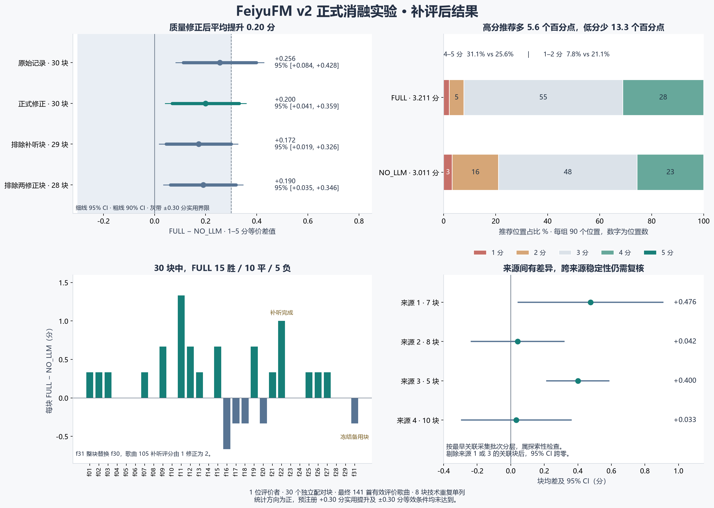

# FeiyuFM v2 单用户配对消融实验

记录日期为 2026-11-11，实验编号为 `rf50-novel-v2-formal-30`，分析修订为 `corrected-1`。研究问题是，在候选、偏好和本地评分保持可比时，LLM 筛选与排名加分能否提高个人音乐推荐满意度。

## 结果与适用范围

在本次冻结候选的单用户盲测中，FULL 平均喜好为 **3.211/5**，NO_LLM 为 **3.011/5**，平均提升 **0.200 分**，95% 配对置信区间为 **[+0.041, +0.359]**，双侧配对 t 检验 p=0.0154。30 个候选块中，FULL **15 胜、10 平、5 负**，存在小幅正向统计证据。

**本次只有 1 位评价者、30 个独立候选块，用户数与样本量有限。** 141 首歌曲是实际评价量，主分析的独立样本量为 30。结论适用于该用户的冻结偏好、指定模型、相似歌曲召回配方及固定试听片段。其他用户、跨来源稳定性和长期使用效果仍待验证。

按评分前冻结的规则，正向实用提升需要同时满足 95% 区间下限大于零及均差至少 +0.30 分。实用近似等效需要整个 90% 区间落在 ±0.30 分内。本次 90% 区间为 **[+0.068, +0.332]**，TOST p=0.1040，两项实用条件均未达到，判定为 **D，实用效果证据仍不足**。

完整精度的统计量、匿名逐块均分、冻结分析规则、来源敏感性及用量见 [匿名结构化汇总](assets/ABLATION_V2_20261111.json)。

## 实验设计

| 项目 | 冻结设计及实际执行 |
|---|---|
| 主要对照 | FULL 启用 LLM 筛选及排名加分，NO_LLM 关闭这两个环节 |
| 共同条件 | 本地评分、长期偏好、当前参考信息、明确反馈、公共选歌规则和候选资格 |
| 候选与输出 | 每块同一份 10 首合格候选，两组各推荐 Top 3 |
| 主分析 | 30 个新增配对块，每块同权，差值为 FULL 减 NO_LLM |
| 实际评分 | 修正后 141 首不同歌曲，每组 90 个推荐位置，共同歌曲只评价一次 |
| 技术重复 | 预选 8 块，单列生成稳定性 |
| 控制 | 相同冻结历史、逻辑时刻和逐候选共同随机扰动，组顺序平衡随机化 |
| 召回 | 网易云相似歌曲二跳配方，每块固定四根、每根最多三个中间曲，候选全局去重 |
| 候选排除 | 冻结参考库、已记录接触及反馈、历史实验候选、已知异版和重复录音、不可用音频 |
| 评价界面 | 匿名编号、默认约 30 秒固定片段，允许继续试听，个人喜好及参考契合度 1–5 分 |

个人喜好是主指标。每首评分先转为 utility，即 `(liking−1)/4`，每组按三个推荐位置计算 Utility@3，再用 `1+4U` 转回直观的 1–5 分等价尺度。共同歌曲的同一份评分复用于两组。旧 v2 校准的 6 个候选块和技术重复各自保留，主分析规模固定为 30 块。

正式规模在模型调用和用户评分之前按实际来源供给冻结为 30 主块、3 备用块。原规划为 32 主块，按任务允许的容量调整完成规模冻结。采用规划标准差下限 0.50、预期差值 0.30 和双侧 α=0.05 时，规划检出把握度为 88.8%，该数值依赖规划假设。

## 环境与运行核验

基线为 FeiyuFM 0.1.2 指定实验安装包、DSH 0.2.2-rc.1、Node 24.21.0 和同一份冻结音乐库。模型路由为 DeepSeek/deepseek-flash，关闭思考，输出上限 2,048 tokens。实验由 PHL 独立实例执行。

运行核对了成对 Prompt 事实、实际模型路由、共同随机值、扣除 LLM 加分后的本地评分一致性、DSH 父进程及七张历史、偏好和反馈相关数据库表。原正式与修正尝试均通过这些核验。NO_LLM 模型调用及排名加分为零。CSV 与各自已锁定评分库逐项一致，Python/scipy 与既有 WebUI JavaScript 的均分及全部逐块差值独立复算一致。

冻结库、分析计划和两份输入 CSV 的 SHA-256 保存在匿名结构化汇总的 `environment` 与 `provenance` 字段。逐块均分足以复算主均差、配对标准差、区间及等效检验。

## 质量修正

原正式盲测完成后确认一首候选属于冻结参考作品的异版，资格过滤漏掉版本后缀。按评分前登记的身份违例规则，用下一冻结备用块整块替换该候选块，并保留相应技术重复。备用块的 FULL 均分为 2.333、NO_LLM 为 2.667，差 −0.333 分，替换降低了原始整体优势。

另有一首曲目原评分为 1 分，评价者备注未听到声音。固定片段可解码且有信号，音量偏低。本次对同一音频及片段实际补听后，个人喜好为 2 分、参考契合度为 2 分，采用该补听记录进行正式修正。

原始均差为 +0.2556 分，整块替换降低 0.0444 分，补听修正再降低 0.0111 分，最终为 +0.2000 分。补充评价发生在评价者获知原始总体结果之后，存在期待影响的可能，补充曲目仍以新匿名编号隐藏组别。

两轮共保存 147 条评分，累计涉及 146 首不同歌曲。最终有效评价集合为 141 首。原始评分、映射、音频和完整调用档案按项目的数据边界保存在本机研究材料中。

## 满意度分布与辅助指标

| 指标 | FULL | NO_LLM |
|---|---|---|
| 平均个人喜好 / 5 | 3.2111 | 3.0111 |
| Utility@3 | 0.5528 | 0.5028 |
| 4–5 分推荐位置 | 28/90，31.1% | 23/90，25.6% |
| 1–2 分推荐位置 | 7/90，7.8% | 19/90，21.1% |
| 各组独有歌曲 | 51 首，均分 3.1569 | 51 首，均分 2.8039 |
| 共同歌曲 | 39 首 | 39 首 |

FULL 的高分推荐比例高 5.6 个百分点，低分比例低 13.3 个百分点。分布与 LLM 减少部分低满意度推荐的解释相符。当前设计同时操纵筛选和排名加分，两个环节各自的贡献仍需机制实验。

参考契合度有 2 首缺失，完整配对块为 28 个，均差 +0.107，95% 区间 [−0.020, +0.234]，p=0.0951。该指标保持辅助地位。

有效歌曲中明确陌生 74 首、熟悉程度不确定 67 首。两组联合推荐全部明确陌生的完整配对块只有 6 个，均差 +0.111，95% 区间 [−0.175, +0.397]。陌生歌曲表现的判断受子集规模及组成限制。

## 敏感性与稳定性

| 分析集合 | 配对块数 | 均差 | 95% 区间 |
|---|---|---|---|
| 正式修正主分析 | 30 | +0.200 | [+0.041, +0.359] |
| 移除补听所在块 | 29 | +0.172 | [+0.019, +0.326] |
| 移除备用块 | 29 | +0.218 | [+0.058, +0.378] |
| 同时移除两个修正块 | 28 | +0.190 | [+0.035, +0.346] |

按每块最早关联采集批次进行探索性分层，四个来源层均差分别为 +0.476、+0.042、+0.400、+0.033 分。移除所有关联来源 1 或来源 3 的块后，整体 95% 区间跨零，结果对候选来源有一定敏感性。候选采集集中在同一天，各子组规模较少，未做多重比较校正。

8 个技术重复中，FULL 平均 Jaccard 为 0.7125，同排名位置一致率为 19/24=79.17%，NO_LLM 两项均为 100%。这些结果衡量重复生成的稳定性。

候选录音去重覆盖文件哈希与精确 Chromaprint，跨编码的近似指纹未覆盖。已确认的版本标记漏检在研究工具中修正。历史日常环境监控中两处文件哈希变化未独立归因，实验使用的冻结输入和归档数据库核验结果另行保留。

## 成本与后续问题

正式阶段连同质量修正共 40 次成功模型任务、1 次启动握手失败，合计 31,875 tokens，任务级失败比例为 1/41=2.44%，补试后所有最终组运行成功。v2 全轮账本包含旧校准、历史隔离批次、失败及被替换运行，共 53 次任务、41,976 tokens、1 次补试。

成功 FULL 组从 Core 就绪后到筛选、选歌及归档的中位耗时为 2.8485 秒，NO_LLM 为 0.173 秒。计时范围不含库恢复与 Core 启动，货币成本未换算。

v1 曾暴露参考原曲混入及分块问题。v2 校准为独立 6 块，均差 +0.1667，95% 区间 [−0.0249, +0.3583]。正式实验方向一致，规模更大，来源和候选组成各有记录。

后续可在新的冻结候选上分别对照“仅筛选”“仅加分”“两者均开”“两者均关”，检验低分减少来自哪个环节，并按不同用户、采集日期和来源固定独立复验规模。长期体验按 [真实试用操作卡](TRIAL.md) 继续收集，当前研究状态见 [PROJECT_PLAN](../PROJECT_PLAN.md)。
