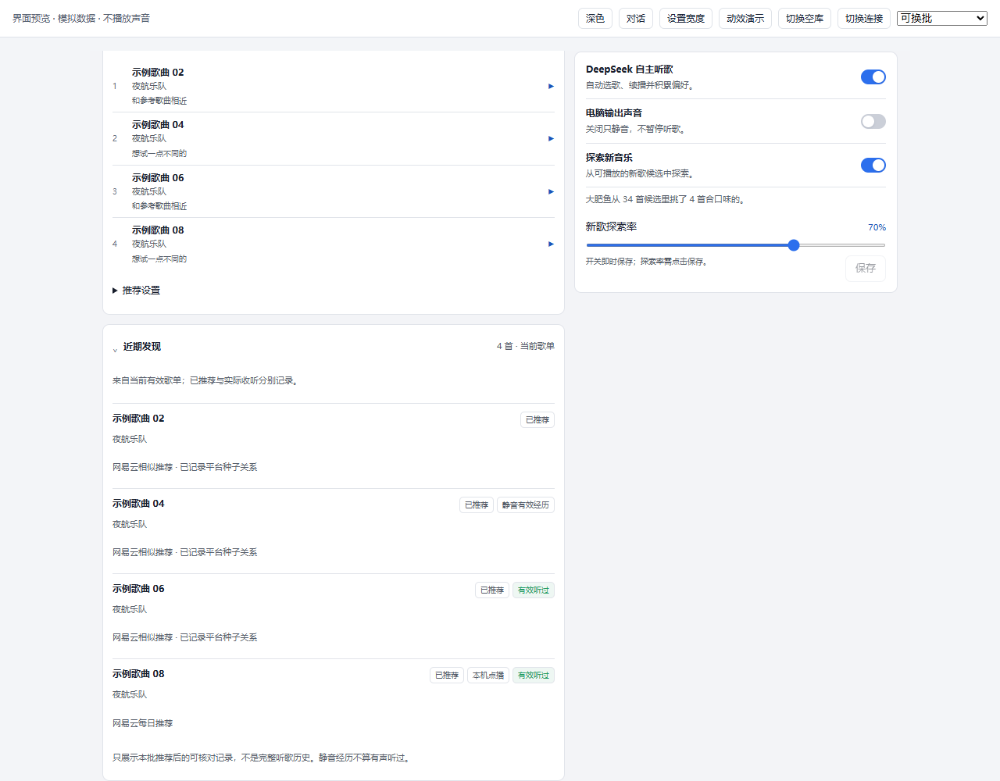
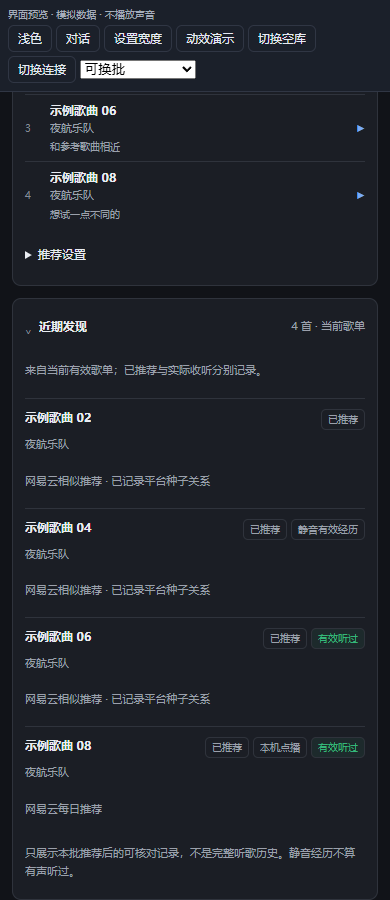

# U19：近期发现只读原型（#4）

2026-10-18。对应 [Issue #4](https://github.com/A7m0spHere/dsh-feiyuFM/issues/4)。本轮交付可运行原型与证据，真实用户反馈尚未完成；任务状态只在 [PROJECT_PLAN](../PROJECT_PLAN.md) 维护。原型运行于现有客户端与 Core DTO，不另建推荐器、聊天 Agent 或桌宠。

## 可查看的结果

现有歌单下增加默认折叠的“近期发现”。展开后显示当前有效歌单中的曲目、艺人、平台来源、可证实的种子关系和筛选前明确反馈。记录状态分开显示“已推荐”“本机点播”“静音有效经历”“有效经历”“有效听过”，不把推荐或播放开始当作已听过。只读列表不附点播/发送/通知按钮，不增加模型或平台请求。





图片使用隔离 Headless Edge 和模拟 RPC，不是原生 Desktop 或真实账号截图。实际客户端 bundle、布局 token、素材路由与生产源码一致，没有新增美术素材或外部界面依赖。

## 来源与记录边界

入口是 `persona.discoveryJournal`，沿现有认证 `fishfm/state`/persona 读取返回，不增加 RPC 路由。实现见 [discovery-journal.mjs](../../src/discovery-journal.mjs)、[Discoveries](../../src/ui/client/discoveries.mjs)。

- 只读投影**当前有效 filtered 批次**，最多 12 首，不是跨批次永久历史。按 track key 去重；批次失效后记录自然隐藏，重启不创建第二条。
- 同时验证筛选记录、完成态账本、原候选映射、owner/revision 与当前有效歌单；切号、清空输入、过期或无法核对时为空。换批失败时只保留仍有效的旧批次，不伪造新发现。
- 自动播放的来源增加可选 `origin.modelCallId`，通过既有 `growth_jobs.entry_json` 保存，不新增表/迁移。自主经历只关联本批 call ID 且开始晚于推荐的已记录播放；旧批次/缺来源记录不补猜。
- 有效状态在本次播放结束、写入既有历史后确认；正在播放时只显示已推荐，并不表示“未听过”。不为刷新显示而提前结束一次播放或增加历史。
- 听过需要测得 `audibleMs` 达到 30 秒或已知时长一半（取较小值），且不超过有效进度、不是错误结束。只有 `audible=true`、少量有声片段或缺失有声计时均不够。自主有效经历但有声不足时不声称人听过；明确 `audibleMs=0` 才能标静音经历。
- 手动点播单独记为本机操作，不当作 Agent 成长；只关联推荐后的同曲本机记录，不据此声称点播由推荐卡片导致。用户环境/历史沿用数据目录范围，没有新增账号级画像隔离。
- 查询通过历史 track key 索引关联既有成长记录，最多读取 200 条、时间不越过当前时刻。更早/已清理/缺失的记录未知，界面不写“未听过”。只读调用不改变数据库总变更数。
- 来源事实复用 [discovery-facts.mjs](../../src/discovery-facts.mjs)，#10 研究从同一模块读取。原 LLM 理由不自动当事实；没有流派、心情或音频理解证据就不生成这些描述。

客户端按快照次序保留新的发现投影；相同服务端时间下，迟到旧平台应答也不能覆盖较新快照清空后的记录。断连隐藏旧条目并提示稍后更新。折叠、隐藏面板、离开页面都不控制 Core/Playback。

## 运行原型

在仓库根目录使用已有 React 18 UMD 测试依赖：

```powershell
npm run preview:ui -- --react-root .tmp/discovery-preview-deps/node_modules --port 4184
```

本轮仅为视觉检查在忽略的该目录安装 React/ReactDOM 18.2.0（关闭安装脚本），没有改变产品依赖或锁文件。预览顶部标明“模拟数据、不播放声音”，所有点播/收听样本都是展示替身。源码浏览器检查可复用任意已有 React 18 测试依赖目录。

## 验证与未验

| 验证面 | 本轮结果 | 实际边界 |
|---|---|---|
| 投影和状态 | 10 项新回归：只读/去重、静音/混合/有声/手动、旧来源、失败/过期/切号/清空、文件库重开、查询上限 | 合成数据与真实内存/文件 SQLite，不操作日常数据库 |
| 客户端 | 2 项新回归：默认折叠、只读状态、断连隐藏；迟到平台响应去旧 | 真实生成 bundle 的受控 RPC；非原生多窗口现场 |
| 推荐流程 | 原有平台→模型→播放回归增加 journal DTO 和 call ID 传递断言，播放/下一首仍只用原有一次模型请求 | 真实 Core，Provider/模型/播放替身 |
| 浏览器 | 1280/740/390/320px、浅深色、键盘、空库、断连、失败保留、设置席位与长文字均通过；展开新增业务 RPC 为 0，控制台 error 为 0 | [浏览器记录](assets/U19-ui-results.json)，隔离模拟 RPC |
| 真实用户 | 未执行 | 等用户查看原型和实际试用，不提前算通过 |
| 日常 Desktop／npm | 未重载／未发布 | 不提升 A01–A10 或真实推荐质量验收 |

全量测试与构建的当前数量统一看 PROJECT_PLAN 首页。用户试用后再决定是否正式落地或扩展跨批次记录；未来主动提醒、消息与分享需独立设计，本轮未启用。
