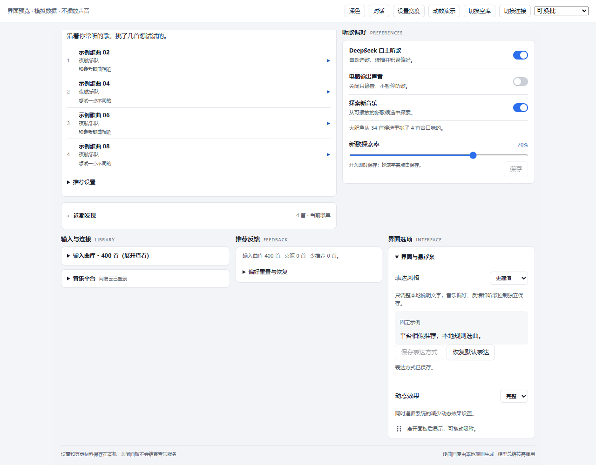
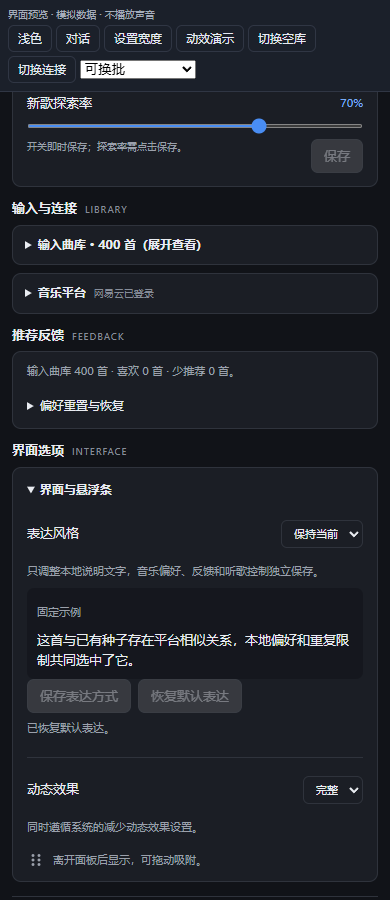

# U20：独立表达风格预设（#5）

2026-10-18。对应 [Issue #5](https://github.com/A7m0spHere/dsh-feiyuFM/issues/5)。用户本轮明确选择少量表达预设；本轮提供功能原型与回归，实际使用收益仍待反馈。最新状态只在 [PROJECT_PLAN](../PROJECT_PLAN.md) 维护。

## 用户可见行为

在“界面选项 → 界面与悬浮条”增加保持当前／更简洁／更活泼。默认与旧数据库的原有文案一致；选择后先显示固定示例，点击保存才改变“肥鱼说”的本地说明。恢复默认只恢复表达，不清空音乐偏好；Core 重开可读取配置。





图片为隔离 Headless Edge、模拟 RPC 和浏览器本机预览存储，不是日常 Desktop 或实际音乐数据库。真正保存到 SQLite 的路径由真实 Core/文件数据库测试验证，不能用预览 localStorage 代替。

## 三类状态的所有权

| 状态 | 存储／所有权 | 读取及优先级 |
|---|---|---|
| 用户环境／明确反馈 | `user_environment/environment_sources/user_track_feedback/constraints`，用户拥有 | 导入、种子、选歌和候选事实；用户命令及硬约束优先，沿用 [#9 语义](../research/PREFERENCE_SIGNALS.md) |
| Agent 偏好／有效经历 | `agent_preferences/listen_history/growth_jobs/session_influence`，有界成长 | 评分、画像与受控模型事实；不从表达风格推断喜好 |
| 表达风格 | `settings.expression_style_v1`，用户单独设置 | 只进入 `insights.expression` 和说明文字渲染；不写前两类状态，不进入模型事实包 |

顺序为暂停／关闭自主／真实故障等状态 → 已记录的来源事实 → 表达预设。新预设明确暂停、关闭自主和静音，不通过文字暗示恢复播放。默认原有文本保持不变；新预设不把自由模型理由改写成亲身体验、情绪或音频理解。

## 配置与兼容

复用现有 settings，无新表或迁移，值为 `{version:1,style,revision}`，style 只接受 `current/concise/lively`。本轮不需要 Markdown 解析器、自由 Prompt、文件读取或导入导出；persona.md 的指令边界和维护成本没有本轮需求依据。任意文字、超长输入、路径和非法版本参数在写入前拒绝。

缺设置时只读回退 current/revision=0，不写默认行。真实改变才增 revision，同值保存不增版本；恢复默认保留递增版本，防止旧窗口覆盖。未知持久化版本显示回退且不可编辑，保留原始配置，不强行降级。

- 认证路由 `fishfm/expression-style` 仅接收 style 和表达配置的 expectedRevision，与播放快照 revision 无关。独立 `expression-style` 消息只写设置，不走播放命令、不改 commandVersion 或模型账本。
- 保存使用独立 busy/取消控制器，暂停和换曲仍可执行；应答不覆盖实时播放。未保存草稿不随轮询改写，服务端事务核对版本，跨窗口冲突后须显式读取新设置再编辑。
- 配置独立去旧；三个本地文案变体随当前事实返回，界面按已确认预设取用，不冻结旧歌曲来保留新风格。
- 旧客户端继续读已选的 reply.text；新客户端连接缺能力的旧 Core 时禁用表达编辑，不影响听歌控制。
- 不读取任意工作区 AGENTS.md、memories.md、私人对话或 persona 文件；没有新逐曲模型调用、常驻会话、主动提醒或主聊天注入。

实现：[服务与格式](../../src/expression.mjs)、[Insights](../../src/insights.mjs)、[客户端](../../src/ui/client/expression.mjs)。本地预览：

```powershell
npm run preview:ui -- --react-root .tmp/discovery-preview-deps/node_modules --port 4184
```

预览调用同一生产验证/格式函数，存储替身使用 `fishfm.preview.*` 浏览器键，仅演练 UI，不访问生产账号、SQLite、音频或模型。

## 验证与未验

| 验证 | 结果与边界 |
|---|---|
| 9 项新后端回归 | 旧库默认精确文案且无写入；音乐数据与模型事实不变；版本冲突及恢复；输入约束；文件库重开与偏好重置；未知版本保留；状态/未知边界；RPC 白名单；真实 Core 不改播放或模型账本 |
| 2 项新客户端回归 | 保存期间可暂停、旧轮询不回退已确认风格；草稿保留与冲突后的显式读取 |
| 既有跨进程 RPC 回归扩展 | 真实 CoreBridge 保存表达，Core 退出重开后配置、暂停和原音乐设置保留；播放后端 fake，不新增平台音频结论 |
| 隔离浏览器 | 1280/740/390/320px 无横向溢出，浅深色、键盘、草稿、保存、重载、双窗口冲突、恢复默认通过；风格操作未发音乐命令或模型操作，控制台 error 为 0；[记录](assets/U20-ui-results.json) |
| 真实用户／日常 Desktop／npm | 实际使用反馈待收集；未重载日常 Desktop、未发布 npm，不提升推荐质量或 A01–A10 |

全量测试、构建和包检查的最新数值看 PROJECT_PLAN 首页。本轮只确认设置隔离和文字原型可运行；自由编辑、分享频次与导入导出保留需求验证后再决定。
