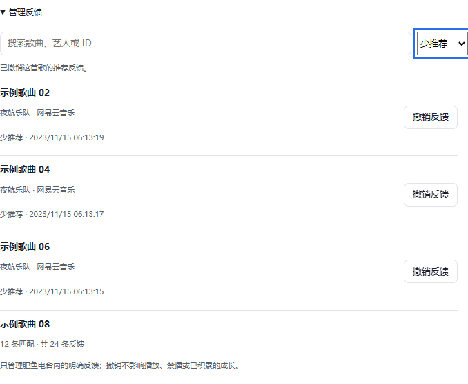
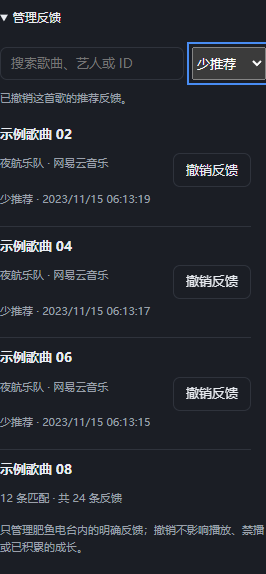

# U21：DSH 插件推荐反馈管理

2026-10-18。用户选择首版“查看与逐条撤销”，以 DSH 插件验证为准，不以日常 Desktop 为前置。最新状态只维护在 [PROJECT_PLAN](../PROJECT_PLAN.md)。

## 交付行为

主面板与设置页共用的“推荐反馈”中增加默认折叠的“管理反馈”，展示歌曲、艺人、反馈类型、更新时间；可搜索、筛选全部／喜欢／少推荐、每页 12 条并逐条撤销。列表在卡片内滚动，保持原有紧凑布局；撤销最后一条时回到有效页。空反馈、无匹配、加载与失败分别呈现。首版没有批量操作、历史反馈互改或播放入口。





图片为生产客户端在隔离 Headless Edge 和模拟 RPC 下的合成数据，不是用户曲库、真实播放或生产验证。

## 数据与并发

复用 `user_track_feedback`，无新表、无迁移、评分权重不变。`settings.feedback_revision_v1` 独立于播放 revision，读旧库默认 0、不写入；所有显式反馈、重置和恢复使版本递增。当前歌曲 `setTrackFeedback` 仍校验曲目和播放实例；历史入口只允许撤销，不绕过原校验开放任意改票。

撤销在事务内先核对 commandId 去重，再校验反馈版本并写 score=0；多窗口冲突返回 `feedback_conflict`，列表刷新后由用户再次决定。中立行不能直接删除：清除反馈后恢复偏好重置时，`INSERT OR IGNORE` 必须看到用户后来的撤销，避免旧票复活。失败回滚反馈与版本；重复请求跨进程重开仍不重复写入。

认证 `fishfm/feedback-list` 和 `fishfm/feedback-clear` 仅转发白名单字段。Host 越过慢平台队列，只返回反馈投影，不返回播放快照；撤销使缓存失效，不主动刷新平台或调用模型。客户端使用独立 busy／取消控制器／查询代次，旧查询和轮询按反馈版本去旧，当前歌曲提示按播放实例匹配。连接旧 Core 时隐藏管理入口，保留原按钮。

## 验证与边界

仓库检查命令：

```powershell
$env:FISHFM_TEST_REAL_AUDIO='0'
npm test
npm run build
npm run verify:package
npm run audit:acceptance
```

宿主检查使用本机官方资源内的 DSH CLI（Electron-as-node）：先由官方 `initializeProfileFromDefault('feedback-u21-web','web',isolatedHome)` 初始化隔离 Web 模板，再执行 `dsh plugin --profile feedback-u21-web add <仓库绝对路径> --offline`。运行时通过额外测试 patch 指定 fake Provider／Playback 和隔离数据库；不手写安装注册或修改日常 profile。临时 HTTP 客户端只核对结果，不输出认证信息。

| 检查 | 结果 |
|---|---|
| 9 项新增后端／RPC 回归 | 旧库无写读取、字面搜索、类型筛选、稳定顺序／分页收敛、文件重开、去重、同时间写冲突、重置版本、防复活、写入失败事务回滚、参数与字段白名单；慢平台队列不阻塞；Core 播放快照／偏好／模型账本保持 |
| 5 项新增客户端回归 | 能力兼容与折叠、查询去旧、查询／撤销期间暂停、迟到快照和当前实例保护、冲突只刷新不重放、未确认请求复用 commandId、接受服务端页码收敛 |
| 完整离线套件 | 538 项：535 通过、0 失败、3 跳过；显式 `FISHFM_TEST_REAL_AUDIO=0`，真实媒体未在本轮重跑 |
| 构建与打包 | 156 模块语法／bundle 一致性、构建/debug smoke、npm dry-run 白名单通过；不是 npm 发布或新发行包验收 |
| 引用审计 | 103 份文档零坏链接、10/10 证据齐全；不改变正式验收等级 |
| 隔离浏览器 | 1280／740／390／320px × 浅深色 8 组无溢出；搜索／筛选／翻页／撤销／键盘顺序通过，控制台错误 0，见 [结构化记录](assets/U21-ui-results.json) |
| 真实 CoreBridge | 隔离文件 SQLite、替身播放：认证查询／撤销、进程退出重开、反馈版本／中立行／暂停保留通过 |
| DSH profile 实测 | 本机 `0.2.1-rc.2`：先用官方 CLI 离线安装源码链接，再从官方 Web 模板建立独立 profile 并启用。真实认证 HTTP RPC 的查询／撤销／去重／冲突／暂停通过，模型调用 0；见 [结果](assets/U21-plugin-results.json) |

首次自定义 profile 只包含 base bundle，没有 Web 认证服务，未算启用通过；改为官方 Web 模板后完成上表实测。安装后的宿主／Core 和预览已关闭，一次性脚本与日志已清理。自动审批以 `blocked by policy` 拒绝删除隔离 profile 内指向仓库的目录链接，因此 `.tmp/feedback-u21-profile/`（含合成数据库）保留，不入 Git 或 npm。没有重载日常实例、操作用户账号或数据、调用真实模型、发声或发布 npm，不提升推荐质量及完整 A01–A10。
