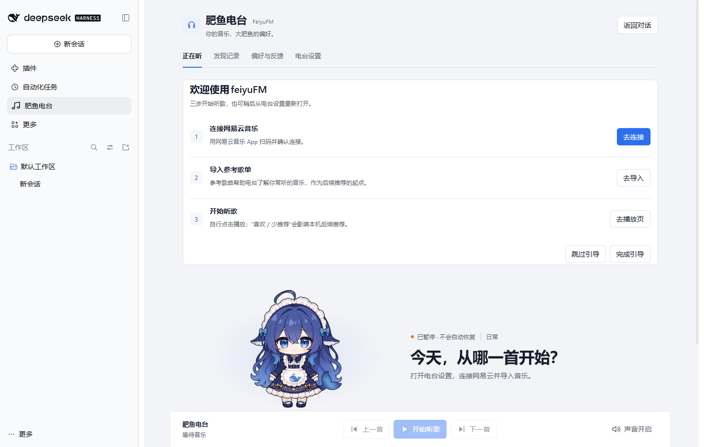
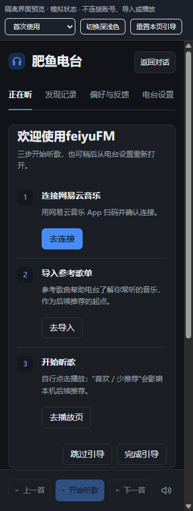
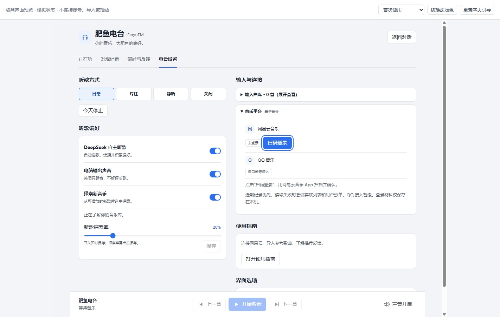

# U25：首次使用轻量引导

2026-11-04。由用户另行启动的 P1 UX 开发，从 P0 `ce463a1` 派生 `feat/first-use-guide`；本轮不发布 npm、不合并 main。未修改 P0 后端、账号校验、音乐数据库 schema、推荐算法或播放实现。

## 实际入口与交互

当前入口为“正在听”→“电台设置”→“输入与连接”→折叠的“音乐平台”，网易云账号行已有扫码与导入控件。引导在正在听页内显示“欢迎使用feiyuFM”卡片，不加遮罩或连续模态。

| 步骤 | 行为 |
|---|---|
| 连接网易云音乐 | 复用页面切换进入电台设置，展开音乐平台，聚焦实际扫码按钮；没有按钮时聚焦账号区域。不发起扫码请求 |
| 导入参考歌单 | 到同一实际账号／导入区域；已授权时聚焦现有“导入来源”，否则聚焦登录并提示先授权。不会自动选择歌单来源、读取列表或导入 |
| 开始听歌 | 返回正在听，聚焦可用播放按钮或引导区域，说明需手动播放及“喜欢／少推荐”影响本机推荐。不自动播放 |

卡片允许跳过或完成。设置页保留“使用指南”入口，主动重开会聚焦卡片，不覆盖先前持久化关闭记录。导航复用原四页逻辑，并避免因引导切页再次请求 profile。正常手动折叠仍可操作；引导打开区域时即时展开以保证焦点可见，没有增加动画。

## 判断与持久化

- P0 初始化成功、平台状态正常且实际曲库与面板原有 profile 读取就绪后，才把没有使用证据的用户判为首次使用。未完成的曲库或读取错误不等于空库，不新增任何读取或 RPC。
- 账号已授权／过期、曲库／导入非空、当前曲目／队列／导航、已有收听或偏好等证据都会静默旧用户；不单靠登录状态。
- 同一浏览器 profile／origin 内使用 `fishfm.guide.v1`，值仅为 `{version:1,status}`。`started` 表示尚未关闭的引导，新客户端依据现有使用证据重判；`skipped/completed/existing` 保持静默。
- 仅看到一次临时挂载不等于用户已完成。未完成的新用户重载后可继续；手动重开不抹除已有跳过／完成记录，只有之后明确关闭才更新。
- localStorage 失败时只保留本次内存状态，不阻止插件功能。禁用存储后的跨次关闭状态不能保证；清理站点存储或更换 profile／origin 也会形成独立状态，不宣称跨 profile 迁移。

## 修改位置

| 文件 | 职责 |
|---|---|
| `src/ui/client/guide.mjs` | 新用户判断、记录解析和无副作用卡片 |
| `src/ui/client/controller.mjs` | 实际曲库就绪、本地状态、关闭与重开、同源同步 |
| `src/ui/client/panel.mjs` | 原页面切换、展开与可访问焦点、永久入口 |
| `src/ui/client/styles.mjs` | 复用现有 token／卡片／按钮，窄屏排布 |
| `scripts/client-bundle.mjs`、`src/ui/dsh-client.js` | 同步客户端生成模块与 bundle |
| `prototypes/fishfm-guide-preview.html`、`scripts/ui-preview.mjs` | 使用生产资源路由的隔离模拟预览 |
| `test/dsh-client.test.mjs`、`scripts/probes/first-use-guide-*.mjs` | 自动回归及真实浏览器／隔离宿主检查；P0 探针的 --guide 分支负责源码链接与重启 |

## 验证

结构化结果见 [U25-guide-results.json](assets/U25-guide-results.json)。

| 层次 | 结果与边界 |
|---|---|
| 新增自动回归 | **12/12**：初始数据未就绪、三步导航、跳过／完成／主动重开、多个旧用户证据、P0 错误优先、存储失败及同源窗口同步 |
| 最终 UI／P0 定向回归 | **98/98**；最后的已连接提示文案补充了对应断言，不改其后端行为 |
| Chrome／真实 React／生产 bundle／模拟 RPC | **21/21**：Tab／Enter、实际登录／导入控件焦点、未完成重载、关闭持久化、旧用户静默、P0 恢复、延迟曲库、存储失败、320／390px 与减少动态效果；无未捕获异常或 React 错误 |
| 官方 DSH 0.2.1-rc.5 隔离 Web profile | **9/9**：通过 CLI 链接本分支源码，默认真实 Core、全新空库、实际点击；引导动作未执行账号／导入／播放方法，模型流计数为 0；真实关闭并重启 DSH/Core 后记录仍为 completed，宿主正常退出 |
| 构建／包／文档 | **185 模块**、完整构建／debug smoke、客户端 bundle 一致性、**4873 文件**包白名单与许可、**119 文档零断链**通过 |
| 完整 `test/`，并发 2 | **738 项、737 通过、1 失败、0 跳过**（94.22 秒）。未修改的 `runtime-evidence` 丢弃计数断言为 2 而非 1，单项复跑通过。保留首跑失败，不修改诊断实现或阈值；P0 之前的播放失败项本轮通过，不据此改写历史成因 |

本轮 DSH 是隔离 Web profile 的源码链接，不冒充正式 npm 包或日常原生 Desktop 验收。宿主自身的新 profile 提示仅在探针中通过正常关闭按钮处理；没有实现或绕过宿主账号授权。已授权后的导入焦点在模拟 UI 中验证，未自动读取或导入真实账号数据；真实手机授权、导入和实际听音留给用户体验。

## 截图与复现

真实隔离 DSH，新用户卡片：



320px、深色、减少动态效果的模拟 UI：



键盘进入现有登录按钮，未发起扫码请求：



```powershell
npm run preview:ui -- --react-root <已有 React 18 node_modules> --port 4187
# http://127.0.0.1:4187/guide?scenario=fresh&reset=1
node scripts/probes/first-use-guide-ui.mjs --url http://127.0.0.1:4187/guide --out <新目录>
node scripts/probes/initial-state-install.mjs --package <源码目录> --out <另一新目录> --guide
```

预览场景均显式标记为模拟状态，不连接账号或播放。所有素材经生产资源路由复用，没有复制到原型目录。原始日常数据／凭据及旧临时加密凭据副本均未触碰。

P1 可供界面体验；完整套件的首跑失败、日常原生 Desktop 及真实账号路径仍需单列。当前状态只维护在 [PROJECT_PLAN](../PROJECT_PLAN.md)，本轮不作为发布许可。
