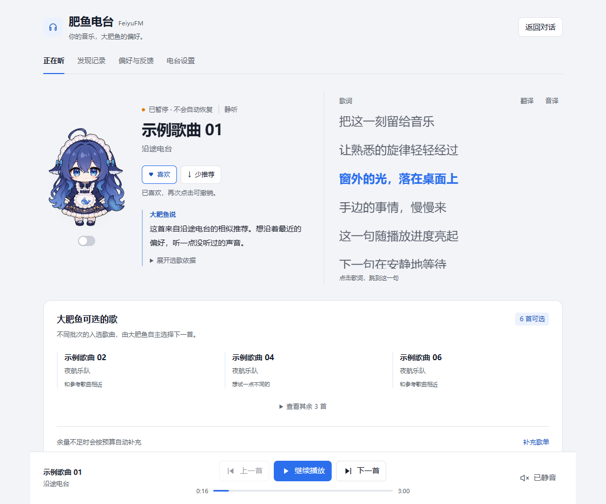

# U26：控制台逐行歌词与原地跳转

日期：2026-11-05。范围为 `feat/console-lyrics`，需求来自用户截图及其后续选择。当前交付状态、测试总数和待验项只在 [PROJECT_PLAN](../PROJECT_PLAN.md) 维护；行为与接口分别见 [MVP](../MVP.md)、[CORE_CONTRACT](../CORE_CONTRACT.md)。本记录不代表 npm 发布或日常 Desktop 已加载。

## 实现与取舍

主面板保留人物、歌曲信息及「大肥鱼说」，收紧人物列，右侧加入独立滚动的歌词区域；较窄时合并陪伴区，再改为上下排列。当前句高亮，默认原文，翻译／音译分别开启。手动浏览暂停跟随，可返回当前句；鼠标与键盘都可定位。

复用已安装的网易云接口包 `lyric` 取词，解析依赖锁定 `lrc-kit@1.2.1`（MIT），只使用 LRC 解析路径。源码／许可调查见[提案](../design/FEAT_CONSOLE_LYRICS.md)，实际复用范围与通知见[第三方声明](../../THIRD_PARTY_NOTICES.md)。词源读取采用匿名会话，不吸收访客 Cookie，不使现有播放账号过期。缓存有界、失败不缓存，账号／登录代次变化去旧，歌词不进入模型输入、快照或数据库。

新增端到端 `seek`，沿 UI → 认证 RPC → Core → PlaybackService → WPF／AVFoundation，沿用播放实例和命令版本。宿主通过 `seekInPlace` 明确声明播放中定位，与旧加载起点能力区分；WPF 在消息循环中等待确认，不用阻塞式重载代替跳转。实际位置可前移／后退，暂停意图保持，新的暂停和换曲优先。定位不累计有效时长，不重新登记开始／历史，不占最近 50 次窗口。失败保留当前曲目并查询宿主实际位置。

关键维护位置：

| 职责 | 文件 |
|---|---|
| 解析、对齐与缓存 | `src/lyrics.mjs`、`src/providers/platform.mjs`、`src/providers/netease.mjs` |
| 独立取词／seek 路由 | `src/core-host.mjs`、`src/ui/dsh-settings.mjs` |
| 命令与经历边界 | `src/contracts.mjs`、`src/core.mjs` |
| 原地定位及暂停优先 | `src/playback/service.mjs`、`src/playback/host/wpf-media-host.ps1`、`src/playback/host/fishfm-macos-host.swift` |
| 显示／加载生命周期 | `src/ui/client/lyrics.mjs`、`controller.mjs`、`panel.mjs`、`styles.mjs`；bundle 由 `npm run build:client` 生成 |

## 验证证据

以下层级分别记录，不能相互替代。

[本轮校验摘要](assets/U26-lyrics-validation.json) 保留首跑／复跑、旧 WPF 媒体超时及接口清单断言修订，最终结果从实际测试日志提取，不把单项复跑覆盖原始失败。

- **离线与本机管道**：新回归覆盖时间标签／offset／间奏、按时间对齐、纯文本与无词、有界缓存、失败不缓存、账号去旧、忽略取消的截止、访客 Cookie 与账号隔离，以及前后定位、暂停、快速连点、旧实例、失败恢复和有效经历。RPC 回归确认慢取词不排队阻塞暂停，取词不改播放 revision。完整与首轮失败结果见开发状态。
- **真实 WPF，静音现场生成 WAV**：`test/playback-seek.test.mjs` 使用实际隐藏 PowerShell、真实命名管道、WPF 解码与位置确认，依次向前、向后、回零、暂停定位；同一宿主与实例保持，未新增 started。生成媒体在测试 finally 清理，不入库。它证明本机定位，不能替代网易云 CDN 或日常播放。
- **真实匿名网易云词源**：[取样摘要](assets/U26-lyrics-remote.json) 只含 ID、响应耗时、状态和规范化后的行数／副行覆盖，不保存全文。普通词、音译和翻译均取得真实返回。匿名音频解析未返回可播资源，因此没有把歌词接口成功当作远端音频同步通过；其中仅含空时间标签的翻译不冒充有效中文翻译。
- **生产 bundle 的浏览器模拟**：现有 `prototypes/fishfm-ui-preview.html` 增加独立的示例歌词与定位状态，复用真实 React、生产 bundle 和资源路由。验证原文默认、开关独立、鼠标／键盘跳转、暂停保持、不因定位重复取词、手动跟随、错误与缺词，以及宽／窄／低高度和浅深色；摘要见 [浏览器检查](assets/U26-lyrics-browser.json)。预览文字是本项目编写的示例，不是网易云歌词。
- **官方隔离 DSH**：从当前源码安装到全新空 profile，使用默认真实 Core，挂载的客户端与所装 bundle 一致、依赖可解析、认证 minimal RPC 和关闭正常。额外检查真实页面的空歌词区域、开关初态，以及歌词／seek 请求确实到达 Core 的曲目／位置校验。[脱敏摘要](assets/U26-lyrics-dsh.json) 不包含认证地址、Cookie 或账号资料。空库未登录，不将其算作真实歌曲播放或日常原生验收。

本轮预览截图（示例词源）：



[深色低高度](assets/U26-lyrics-dark.png) · [深色窄窗口](assets/U26-lyrics-narrow.png)

## 复现入口

```powershell
npm run build:client
node --test --test-concurrency=1 test/lyrics.test.mjs test/lyrics-rpc.test.mjs test/core-seek.test.mjs test/playback-seek.test.mjs
npm run check
npm run build
npm run audit:acceptance
npm run verify:package
```

浏览器预览沿用 `npm run preview:ui -- --react-root <已有 React 18 UMD 目录> --port 4198`，默认显示示例逐行词；查询参数 `?lyrics=unavailable/instrumental/unsynced/error` 可分别检查降级状态。生产界面不提供此参数或示例数据。

隔离安装与路由验证：

```powershell
node scripts/probes/initial-state-install.mjs --package . --out <全新隔离目录> --lyrics
```

macOS 已补 AVFoundation 定位实现与能力声明，但本机无法编译／执行，保留真机验证边界。日常 Desktop、真实账号／远端网易云音频与歌词同步也须按对应来源补证。缺证据不提升 A01–A10，也不因本次源码提交自动发布。

返回 [记录索引](README.md)。
