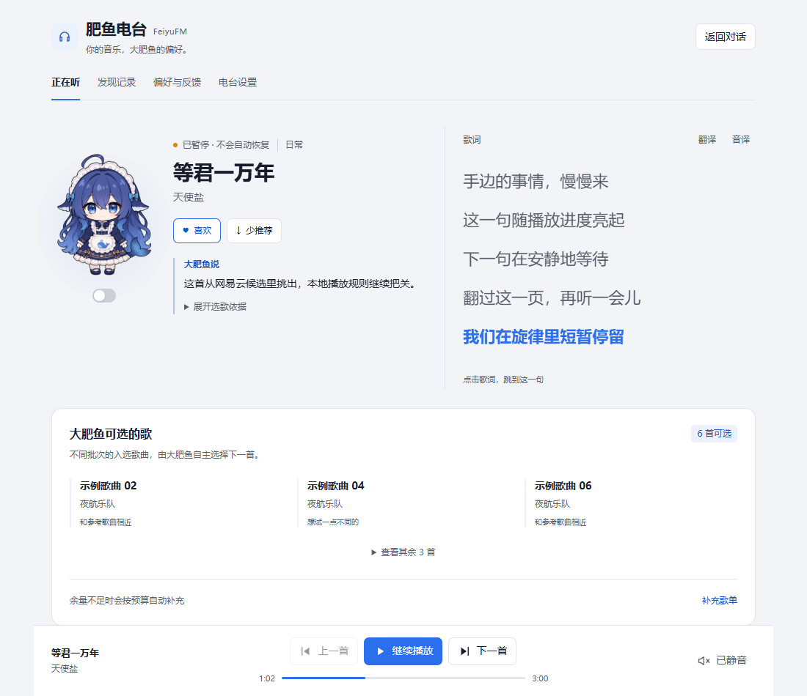

# U27：陪伴区 A 方案横排

日期：2026-11-05。用户指出人物周围留白过多，要求人物左、文本右；比较均衡横排、紧凑横排和说明卡片三个预览后选择 A。当前状态与检查数量维护在 [PROJECT_PLAN](../PROJECT_PLAN.md)，用户行为见 [MVP](../MVP.md)。

## 原因与调整

U26 的中等宽度规则会在 960px 容器条件下将人物和文本改成两行，人物占据上方整行，使歌曲信息与说明之间形成较大的纵向空白。本轮保留 A 预览的均衡比例：常用宽度下人物 144×176px、列间隔 22px，文本集中在右侧；陪伴区与歌词区顶端对齐。

文本列保持 `minmax(0,1fr)`，长歌名与艺人允许换行。容器内容宽度不大于 760px 时仅把歌词移到下一行；不大于 560px、340px 时分别缩小人物，人物与文本仍并排。该断点以面板内容宽度为准，不是整个桌面的宽度。正常反馈的重复说明收起，按钮保留按下状态；读取和错误说明继续可见。彩蛋无文字小开关、歌词控件和播放控制沿用原行为。

维护源为 `src/ui/client/styles.mjs`，生成 bundle 已通过 `npm run build:client` 同步；没有新增依赖或接口。

## 验证与来源

使用现有生产客户端与预览资源路由，仅隐藏开发工具栏／侧栏；账号、歌曲、说明与歌词为示例。未连接日常 Desktop、真实账号、音频或模型。原始人物仍来自 `src/ui/assets/whale-idle.png`，未复制运行素材，角色许可及署名按 [第三方声明](../../THIRD_PARTY_NOTICES.md) 保持。

[浏览器检查摘要](assets/U27-companion-a-checks.json) 覆盖 1220、1100、1000、960、900、840、800、740、640、560、440、360、300、225px 视口的浅深色：检查人物位于文本左侧、歌词按宽度排布、页面无横向溢出和小开关可见。另检查长标题／无空格艺人名、低高度、歌词点击保持暂停、播放／暂停按钮和反馈错误仍可见。没有新增仅复述 CSS 的自动化测试，复用既有客户端回归并执行构建。

下图来自本轮实际生产 CSS；用用户提供的歌名和说明帮助比较，仍为预览样例，不是新的日常实例验收：

## 日常 Desktop 加载

2026-11-05，用户要求在 Desktop 加载。将 `9cb65d9` 打成包含运行依赖的本地候选包，经日常 Desktop 插件管理器安装并启用，再通过应用菜单正常退出并重新启动。安装后的客户端 bundle、样式模块与播放服务分别与该提交源码的 SHA-256 一致。

候选包为 `.tmp/desktop-a-9cb65d9/dsh-feiyufm-0.1.1.tgz`，SHA-256：`34b2446034858956f3667ec22f9014f61313c498a3176304946c7b94813286f2`。Desktop profile 当前引用该本地文件，需保留，不能因其位于 `.tmp` 而当作普通预览缓存清理。

实际重启后的页面已显示人物左、歌曲与说明右的 A 布局；歌曲、3:14 暂停位置、网易云已登录状态和 251 首输入曲库保持。最终停留在「正在听」并保持暂停。本轮现场范围为安装、重启、布局与状态保持；不将预览或文件一致性提升为新的音频／模型验收。

此前 README 截图继续按其标明的 `21e170c` 与日期理解；本轮没有改写旧截图证据。该本地候选加载不代表 npm 发布。

返回 [记录索引](README.md)。
